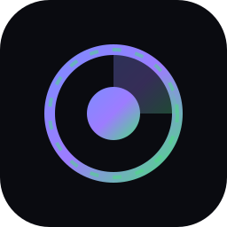

<div align="center">


# Overchat Bulk → 9Router

**Bulk-create Overchat accounts · auto-harvest tokens & cookies · serve a load-balanced OpenAI-compatible pool to 9Router.**

[](https://nodejs.org)
[](package.json)
[](https://9router.com)
[](https://platform.openai.com/docs/api-reference)
[](LICENSE)
[](#-readme-languages)
[](#contributing)

[English](README.md) · [Bahasa Indonesia](readmes/README.id.md) · [中文](readmes/README.zh.md) · [日本語](readmes/README.ja.md) · [Español](readmes/README.es.md)

</div>

---

## What this is

A **zero-dependency Node toolkit** that turns Overchat into a scalable OpenAI-compatible
backend for [9Router](https://9router.com):

1. **Bulk-create** Overchat accounts over pure HTTP (no browser required).
2. **Auto-harvest** the `access-token` JWT and session cookies for each account.
3. **Load-balance** them in a self-healing account pool with round-robin + failover.
4. **Register** the pool into 9Router as a single OpenAI-compatible provider.

Every account gets a **unique identity** and its **own free quota** — no shared demo
account, no per-request throttling.

<div align="center">

</div>

---

## Why it works (the key trick)

Overchat's API issues a 30-day JWT from `POST /v1/auth/email/verify`. The catch:

| Approach | Result |
|----------|--------|
| Plain email login | Collapses onto the **shared Demo Account** (`sub 00000367-…`) — throttled, no quota |
| Email login **+ a fresh `x-device-uuid`** on both `send-code` and `verify` | A **unique account**: own `sub`, `isGuest:false`, **100 takosCoin** |

The toolkit always sends a per-account device UUID, so each created account is distinct
and independently usable.

> **Inbox note.** Overchat **rejects disposable domains** (`422 "This email provider is not
> supported"`). Use a real mailbox that supports **plus-addressing**
> (`you+tag@domain`) — one inbox, unlimited addresses.

---

## Architecture

```
        ┌─────────────────────────────────────────────────────────────┐
        │                    overchat-bulk-9router                    │
        └─────────────────────────────────────────────────────────────┘

  ┌────────────┐   plus-addr    ┌──────────────┐   send-code / verify
  │  Mailbox   │───────────────▶│   src/inbox  │──────────────┐
  │ (real mail)│◀─── code ──────│  (providers) │              │
  └────────────┘                └──────────────┘              ▼
                                                    ┌──────────────────┐
  ┌────────────┐   accounts.json  ┌────────────┐    │  api.overchat.ai │
  │  src/cli   │─────────────────▶│  src/pool  │    │  /v1/auth/*      │
  │  create N  │                  │ round-robin│    │  /v1/personas    │
  └────────────┘                  │  +cool-down│    │  /v1/chat/…     │
                                  └─────┬──────┘    └────────┬─────────┘
                                        │                    │ SSE
                                        ▼                    ▲
                          ┌────────────────────────┐         │
                          │  src/adapter.js :8790  │─────────┘
                          │  OpenAI-compatible     │
                          │  /v1/models            │
                          │  /v1/chat/completions  │
                          └───────────┬────────────┘
                                      │ register
                                      ▼
                          ┌────────────────────────┐
                          │   9Router  :20128      │
                          │  provider: overchat/*  │
                          └────────────────────────┘
```

See [`STRUCTURE.md`](STRUCTURE.md) for the full file tree and
[`docs/PROTOCOL.md`](docs/PROTOCOL.md) for the reverse-engineered API.

---

## Install

```bash
git clone <repo-url> overchat-bulk-9router
cd overchat-bulk-9router
# nothing to install — Node ≥ 18, zero dependencies
```

---

## Quick start

```bash
# 1. Configure your inbox (a REAL mailbox that supports plus-addressing)
cp config.example.json config.json
export OVERCHAT_MAILBOX="you@example.com"

# 2. Bulk-create accounts (each gets its own quota)
node src/cli.js create --count 5 --concurrency 2

# 3. Inspect the pool
node src/cli.js list
node src/cli.js health
node src/cli.js test auto-model

# 4. Serve the OpenAI-compatible pool
node src/adapter.js            # http://127.0.0.1:8790/v1

# 5. Register it into 9Router
node src/connect-9router.js --router https://9router.com --password <pw>
```

Then point any client at 9Router:

```bash
curl http://127.0.0.1:20128/v1/chat/completions \
  -H "Authorization: Bearer $NINEROUTER_KEY" \
  -H "Content-Type: application/json" \
  -d '{"model":"overchat/auto-model","messages":[{"role":"user","content":"hello"}]}'
```

---

## CLI reference

| Command | Description |
|---------|-------------|
| `create --count N [--concurrency C] [--timeout MS]` | Bulk-create accounts into `accounts.json` |
| `list` | Show the account pool |
| `health` | Ping every account (`/v1/auth/me`) |
| `test [model]` | One live completion on a pooled account |
| `models` | List text models from a pooled account |
| `serve` | Run the OpenAI-compatible pool adapter |
| `connect` | Register the adapter into 9Router |

### Adapter endpoints

| Method | Path | Description |
|--------|------|-------------|
| `GET` | `/v1/models` | All `overchat/*` models |
| `POST` | `/v1/chat/completions` | Chat (stream + non-stream) |
| `GET` | `/health` | Pool + model counts |
| `GET` | `/pool` | Per-account status |
| `POST` | `/pool/reload` | Reload `accounts.json` |

---

## Models

Overchat exposes **~340 text/auto models** (plus image/video). Names are the persona
slugs. Popular ones:

`auto-model` · `gemini-3-5-flash` · `claude-5-sonnet` · `claude-opus-5` · `gpt-5-2` ·
`grok-4-5` · `deepseek-v-3-2` · `qwen-3-7-max` · `kimi-k3` · `glm-5-3`

> Premium models return **403 "This bot is only available on paid plans"** on free
> accounts. Free accounts can use `auto-model` (GPT-5 nano) and `gemini-3-5-flash`.

---

## Configuration

`config.json` (see `config.example.json`):

| Key | Env | Default | Meaning |
|-----|-----|---------|---------|
| `mailbox` | `OVERCHAT_MAILBOX` | — | Base address for plus-addressing |
| `inboxProvider` | `OVERCHAT_INBOX` | auto | `agentmail` \| `imap` |
| `poolFile` | `OVERCHAT_POOL` | `accounts.json` | Pool store |
| `adapterUrl` | `ADAPTER_URL` | `http://127.0.0.1:8790/v1` | What 9Router calls |
| `prefix` | `OVERCHAT_MODEL_PREFIX` | `overchat` | Model id prefix |
| `port` | `PORT` | `8790` | Adapter port |
| `router` | `ROUTER_URL` | `https://9router.com` | 9Router base |
| `routerPassword` | `ROUTER_PASSWORD` | `123456` | 9Router admin password |

---

## Inbox providers

Overchat blocks disposable domains, so you need a **real** mailbox:

- **agentmail** — plus-address a single mailbox; simplest for CI/automation.
- **imap** — read a normal mailbox over IMAP (`npm i imapflow`); supply host/user/pass.

---

## Optional: local Chromium

The bulk flow is **pure HTTP and needs no browser**. If you prefer to drive the Overchat
web UI (e.g. to read a session cookie after a manual login), `src/chromium.js` launches a
**local Chromium** with a debug port and reads the `access-token` cookie. No cloud
service, no remote browser — just `--remote-debugging-port`.

```js
const { Chromium } = require('./src/chromium');
const ch = await new Chromium({ port: 9222 }).launch();
console.log(await ch.readOverchatToken());
await ch.close();
```

---

## Notes & limitations

- **Free quota:** 100 takosCoin/day per account, renews daily. Premium models are locked.
- **Provider block:** disposable mail domains are rejected — use a real mailbox.
- **Token lifetime:** 30 days; re-run `create` or add a refresh job when they expire.
- This is an interoperability/automation toolkit for **your own** accounts. Respect
  Overchat's Terms of Service and any applicable law.

---

## 🌐 README languages

- 🇬🇧 [English](README.md)
- 🇮🇩 [Bahasa Indonesia](readmes/README.id.md)
- 🇨🇳 [中文](readmes/README.zh.md)
- 🇯🇵 [日本語](readmes/README.ja.md)
- 🇪🇸 [Español](readmes/README.es.md)

---

## Contributing

Issues and PRs are welcome. Keep the zero-dependency policy: Node built-ins only
(`imapflow` is the sole optional peer, used only by the IMAP inbox).

## License

[MIT](LICENSE) © 0xgetz
