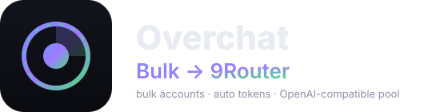

<div align="center">



# Overchat Bulk → 9Router

**Buat akun Overchat secara massal · ambil token & cookie otomatis · sajikan sebagai pool OpenAI-compatible yang load-balanced ke 9Router.**

[](https://nodejs.org)
[](../package.json)
[](https://9router.com)
[](https://platform.openai.com/docs/api-reference)
[](../LICENSE)

[English](../README.md) · [Bahasa Indonesia](README.id.md) · [中文](README.zh.md) · [日本語](README.ja.md) · [Español](README.es.md)

</div>

---

## Apa ini

Toolkit Node **tanpa dependensi** yang mengubah Overchat menjadi backend
OpenAI-compatible yang skalabel untuk [9Router](https://9router.com):

1. **Buat massal** akun Overchat lewat HTTP murni (tanpa browser).
2. **Ambil otomatis** JWT `access-token` dan cookie sesi tiap akun.
3. **Load-balance** dalam pool akun mandiri (round-robin + failover + cooldown).
4. **Daftarkan** pool ke 9Router sebagai satu provider OpenAI-compatible.

Setiap akun punya **identitas unik** dan **kuota gratisnya sendiri** — bukan akun demo
bersama.

## Kenapa berhasil (trik utamanya)

| Cara | Hasil |
|------|-------|
| Login email biasa | Menyatu ke **Demo Account bersama** (`sub 00000367-…`) — ter-throttle |
| Login email **+ `x-device-uuid` baru** pada `send-code` dan `verify` | Akun **unik**: `sub` sendiri, `isGuest:false`, **100 takosCoin** |

> **Catatan inbox.** Overchat **menolak domain disposable** (`422`). Gunakan mailbox asli
> yang mendukung **plus-addressing** (`kamu+tag@domain`).

## Mulai cepat

```bash
cp config.example.json config.json
export OVERCHAT_MAILBOX="kamu@example.com"
node src/cli.js create --count 5 --concurrency 2
node src/cli.js health
node src/adapter.js            # http://127.0.0.1:8790/v1
node src/connect-9router.js --router https://9router.com --password <pw>
```

```bash
curl http://127.0.0.1:20128/v1/chat/completions \
  -H "Authorization: Bearer $NINEROUTER_KEY" -H "Content-Type: application/json" \
  -d '{"model":"overchat/auto-model","messages":[{"role":"user","content":"halo"}]}'
```

## Perintah CLI

| Perintah | Keterangan |
|----------|------------|
| `create --count N` | Buat massal akun ke `accounts.json` |
| `list` / `health` | Lihat pool / cek semua akun |
| `test [model]` | Satu completion langsung |
| `models` | Daftar model teks |
| `serve` | Jalankan adapter OpenAI-compatible |
| `connect` | Daftarkan adapter ke 9Router |

## Model

~340 model teks/auto (mis. `auto-model`, `gemini-3-5-flash`, `claude-5-sonnet`). Model
premium butuh plan berbayar (403). Akun gratis: `auto-model`, `gemini-3-5-flash`.

## Catatan

- Kuota gratis 100 takosCoin/hari per akun, diperbarui harian.
- Domain email disposable ditolak — pakai mailbox asli.
- Token berlaku 30 hari.
- Gunakan hanya untuk akun milikmu sendiri; patuhi ToS Overchat.

Ikuti [README English](../README.md) untuk dokumentasi lengkap, `STRUCTURE.md`, dan
`docs/PROTOCOL.md`.

## Lisensi

[MIT](../LICENSE) © 0xgetz
